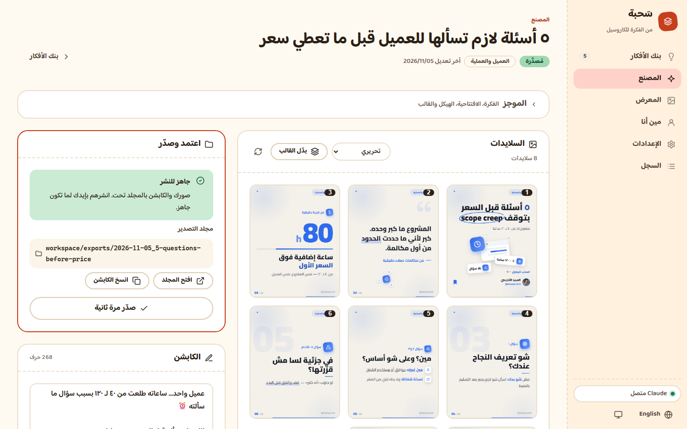

# Sahba (سَحبة)
**An Instagram carousel factory for Arabic content creators.** Write your idea; Claude writes the carousel in your voice; Sahba renders professional PNG slides (1080×1350) in your identity — ready to post.

> Images only. No video, motion or audio.
> **Free and open source** · made by [Alsaeyd Al-Akhras](https://instagram.com/alsaeyd.tech) · [README بالعربي](README.md) · Arabic step-by-step guide: [docs/GUIDE.md](docs/GUIDE.md)



---

## What it does
```
Who you are → identity & voice → idea bank → "Make" → preview → your comments → "Approve & export" → folder of images + caption → you post manually
```
- **Your voice:** answer a short profile once; Claude analyzes your audience, pillars and way of speaking, and writes from that.
- **Real graphics:** icons, app window, fanned cards, icon orbit, hand-drawn circle, marker — the graphic explains the idea.
- **Several templates:** each shown in a real preview with your identity. Switch any carousel's template in one click, no rewrite.
- **Everything runs locally.**

## Requirements
| | |
|---|---|
| **Node.js 22+** | [nodejs.org](https://nodejs.org) (LTS) |
| **Google Chrome or Microsoft Edge** | Any one installed — used in the background for rendering |
| **Claude Code** | Installed and logged in **with your Claude subscription** (Pro or Max). No API keys. |
| OS | Windows 10/11 or macOS |

Install Claude Code from the official instructions at [claude.com/claude-code](https://claude.com/claude-code), then run `claude` once in a terminal and log in.

## Install
1. Download from GitHub (**Code → Download ZIP**, then unzip anywhere) or `git clone https://github.com/alsaeyd-alakhras/sahba.git`.
2. Run:
   - **Windows:** double-click `start.bat`.
   - **macOS:** first time only, open Terminal in the folder and run `chmod +x start.command`; then double-click `start.command` (if macOS blocks it: right-click → Open).
3. Your browser opens `http://127.0.0.1:8900`. Keep the terminal window open while you work.

## First run — the wizard (4 steps)
1. **Language:** Arabic or English (the whole UI flips RTL/LTR).
2. **Profile questions:** what you do, who you talk to, what followers should do, your topics, your dialect, writing samples, what you hate in content.
3. **Identity:** name, handle, role, photo (drag to position your face), main color, font — with a live slide preview.
4. **Template:** see every template with your identity and pick the default.

Then press **"Analyze"** on the "Me" page: Claude writes your audience analysis, pillars and voice rules — all editable cards.
Want to try first? A ready demo workspace lives in `demo/workspace` (fictional creator) — see FAQ.

## Daily workflow
1. **Ideas:** add an idea in one line — or **"Suggest ideas"** for 10 from your pillars.
2. **"Polish"** an idea: a hook with a concrete number + a 5–7 point outline → status "ready".
3. **"Make"** in the Factory: Claude writes → automatic checks → slide-by-slide render → visual QA → the grid of slides.
4. **Comment** on any slide ("shorten the title", "swap the icon") → Claude changes only those slides. Or **"Switch template"** (render only, no Claude). Every change is saved as a version you can restore.
5. **"Approve & export"** → a folder with `01.png … 08.png` + `caption.txt` + a contact sheet. "Open folder" and "Copy caption".
6. **Post manually** on Instagram (upload in order, 01 first), then mark the idea "published" and paste the post link.

## Templates
| Template | Look | Fits |
|---|---|---|
| **Editorial** (default) | Light dotted background + your color + hand circle + your photo | Educational, listicles, anything |
| **Midnight** | Dark + cards + light accent | Comparisons, tools, tech |
| **Gradient** | Dark gradient + huge numbers | Numbers, facts |
| **Mono** | Sharp black/white + one accent | Opinions, quotes, minimal brands |

Your main color is applied on top of any template.

## Where your files live
All your data is in one folder: **`workspace/`** inside the app folder.
```
workspace/
├── settings.json        your settings
├── brand/               identity, photo, profile, analysis, voice rules
├── ideas/ideas.json     idea bank
├── decks/               each carousel's text (+ previous versions)
├── preview/             temporary previews
├── exports/             ⭐ ready-to-post carousels: YYYY-MM-DD_name/
└── logs/                run log (for support)
```
**Back up `workspace/`** now and then — it is all your work.

## Without the dashboard (optional)
Open Claude Code in the app folder and say "make a carousel about …". Claude writes the deck to `workspace/decks/` and renders a preview to `workspace/preview/`. Final export is done from the dashboard.
In this folder Claude is not allowed to edit the app's code — it only writes inside `workspace/`.

## Troubleshooting
Open **Settings → Device / Claude**: the Doctor checks Node, Chrome/Edge, Claude Code, login and disk space; every red check shows the fix.
| Problem | Fix |
|---|---|
| `start.bat` says Node is missing or too old | Install Node.js 22+ from nodejs.org and start again |
| Claude "not installed" | Install Claude Code and make sure `claude` works in a terminal |
| Claude "not logged in" | Open a terminal, run `claude`, log in with your subscription, then press "Check connection" |
| "Chrome/Edge not found" | Install either one, or set its path in the `CHROME` environment variable |
| The page doesn't open | Make sure the terminal window is open and visit `http://127.0.0.1:8900`. Port busy: close the other copy, or start with `PORT=8901` |
| Text cut off on a slide | Comment on the slide ("text overflows") or press "Redo this slide" |
| Anything else | The **Log** page has the latest runs and errors — send it to support |

## Privacy
- Everything is **local**: data, images, rendering. The server listens on `127.0.0.1` only (not visible on your network).
- The only thing that leaves your machine is the text Claude needs while writing — **to Claude itself, through your own account**.
- No analytics, no tracking, no scraping of your accounts — you paste what you want.

## Updating
Download the new version and replace **every file and folder except `workspace/`**. Your work stays as it is.
(To be safe, copy `workspace/` before updating.)

## FAQ
- **Can I try it on demo data?** Yes: start the server with `SAHBA_WORKSPACE` set to `demo/workspace` (Windows: `set SAHBA_WORKSPACE=demo\workspace` then `node app\server.mjs`; macOS: `SAHBA_WORKSPACE=demo/workspace node app/server.mjs`).
- **Does it work offline?** Rendering yes (fonts and icons are local). Writing needs internet because it uses Claude.
- **Several accounts/identities?** This version supports one identity.

Free and open source — [MIT](LICENSE) · Fonts and icons: [THIRD_PARTY_NOTICES.md](THIRD_PARTY_NOTICES.md)
