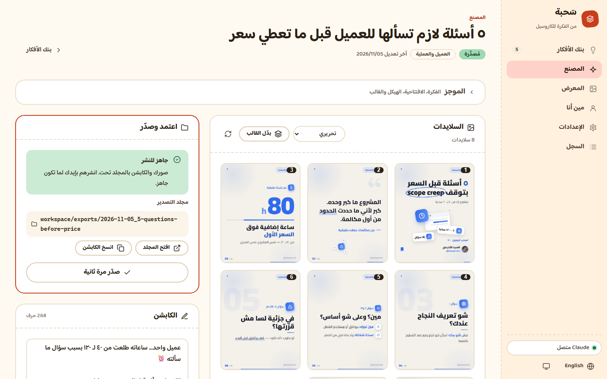

# سَحبة — Sahba
**مصنع كاروسيل انستغرام لصنّاع المحتوى بالعربي.** بتكتب فكرتك، وClaude بيكتب الكاروسيل بصوتك، والبرنامج بيرسمه صور PNG احترافية (1080×1350) بهويتك — جاهزة للنشر.

> صور فقط. لا فيديو ولا موشن ولا صوت.
> **مجانية ومفتوحة المصدر** · صنعها [السيد الأخرسي](https://instagram.com/alsaeyd.tech) · [English README](README.en.md)
>
> 📘 **الدليل خطوة بخطوة بالصور:** [docs/GUIDE.md](docs/GUIDE.md)



---

## شو بتعمل سَحبة؟
```
مين إنت ← هويتك وصوتك ← بنك أفكارك ← «اصنع» ← معاينة ← تعليقاتك ← «اعتمد وصدّر» ← مجلد صور + كابشن ← بتنشر بإيدك
```
- **بصوتك:** بتجاوب أسئلة تعريف مرة وحدة، وClaude بيحلّل جمهورك ومحاورك وطريقة كلامك ويكتب على أساسها.
- **رسومات حقيقية:** أيقونات، نافذة تطبيق، كروت مروحة، مدار أيقونات، دائرة يد، ماركر — الرسمة بتشرح الفكرة مش زينة.
- **أكثر من قالب:** بتشوف كل قالب بمعاينة حقيقية بهويتك، وبتختار الأساسي. وتقدر تبدّل قالب أي كاروسيل بكبسة بدون إعادة كتابة.
- **كل إشي محلي على جهازك.**

## المتطلبات
| | |
|---|---|
| **Node.js 22 أو أحدث** | من [nodejs.org](https://nodejs.org) (نسخة LTS) |
| **Google Chrome أو Microsoft Edge** | أي واحد مثبّت عندك — البرنامج بيستخدمه للرسم بالخلفية |
| **Claude Code** | مثبّت ومسجّل دخول **باشتراكك بـ Claude** (Pro أو Max). ما في مفاتيح API. |
| النظام | Windows 10/11 أو macOS |

تثبيت Claude Code: اتبع التعليمات الرسمية على [claude.com/claude-code](https://claude.com/claude-code)، وبعدين افتح الترمنال واكتب `claude` مرة وحدة وسجّل دخول.

## التثبيت
1. نزّلها من GitHub: زر **Code ← Download ZIP** وفكّ الضغط بأي مكان، أو `git clone https://github.com/alsaeyd-alakhras/sahba.git`.
2. شغّل:
   - **Windows:** دبل كليك على `start.bat`.
   - **macOS:** أول مرة بس: افتح Terminal بالمجلد واكتب `chmod +x start.command`، وبعدين دبل كليك على `start.command` (لو الماك منعه: كليك يمين ← Open).
3. المتصفح بيفتح لحاله على `http://127.0.0.1:8900`. خلّي نافذة الترمنال مفتوحة طول ما إنت شغّال.

## أول تشغيل — المعالج (٤ خطوات)
1. **اللغة:** عربي أو English (الواجهة بتتقلب بالكامل).
2. **أسئلة التعريف:** شو بتشتغل، لمين بتحكي، شو بدك المتابع يعمل، مواضيعك، لهجتك، أمثلة من كتابتك، شو بتكره بالمحتوى.
3. **الهوية:** الاسم، اليوزر، الدور، صورتك (وبتسحب لمكان الوجه)، لونك الأساسي، الخط — مع معاينة سلايد حية.
4. **القالب:** بتشوف القوالب بهويتك وبتختار الأساسي.

بعدها اضغط **«حلّل»** بصفحة «مين أنا»: Claude بيكتب تحليل جمهورك ومحاورك وقواعد صوتك. كلها كروت بتقدر تعدّلها بإيدك.
بدك تجرّب قبل؟ في مساحة عمل تجريبية جاهزة بـ `demo/workspace` (شخصية وهمية) — شوف «أسئلة شائعة» تحت.

## الشغل اليومي
1. **بنك الأفكار** (`الأفكار`): ضيف فكرة بسطر — أو اضغط **«اقترح أفكار»** وClaude بيقترح ١٠ من محاورك.
2. **«صقّل»** على أي فكرة: افتتاحية برقم ملموس + هيكل ٥–٧ نقاط ← الفكرة بتصير «جاهزة».
3. **«اصنع»** بالمصنع: Claude بيكتب ← فحص تلقائي ← رسم سلايد سلايد ← فحص بصري ← شبكة الصور قدامك.
4. **علّق** على أي سلايد («قصّر العنوان»، «بدّل الأيقونة») ← Claude بيعدّل بس السلايدات اللي علّقت عليها. أو **«بدّل القالب»** (رسم بس، بلا Claude). كل تعديل بينحفظ كنسخة وبتقدر ترجعلها.
5. **«اعتمد وصدّر»** ← مجلد فيه `01.png … 08.png` + `caption.txt` + ورقة معاينة. «افتح المجلد» و«انسخ الكابشن».
6. **انشر بإيدك** على انستغرام (ارفع الصور بالترتيب، 01 أول)، وبعدين علّم الفكرة «منشورة» وحط رابط البوست.

## القوالب
| القالب | الشكل | بيناسب |
|---|---|---|
| **Editorial** (افتراضي) | خلفية فاتحة منقّطة + لونك + دائرة يد + صورتك | تعليمي، قوائم، أي موضوع |
| **Midnight** | غامق + كروت + لون فاتح | مقارنات، أدوات، تقني |
| **Gradient** | تدرّج غامق + أرقام ضخمة | أرقام، حقائق |
| **Mono** | أبيض/أسود حاد + لون واحد | آراء، اقتباسات، براند بسيط |

لونك الأساسي بيتطبّق فوق أي قالب.

## وين ملفاتك؟
كل بياناتك بمجلد واحد: **`workspace/`** جوّا مجلد البرنامج.
```
workspace/
├── settings.json        إعداداتك
├── brand/               هويتك، صورتك، التعريف، التحليل، قواعد الصوت
├── ideas/ideas.json     بنك الأفكار
├── decks/               نص كل كاروسيل (+ نسخه السابقة)
├── preview/             معاينات مؤقتة
├── exports/             ⭐ الكاروسيلات الجاهزة للنشر: YYYY-MM-DD_اسم/
└── logs/                سجل التشغيل (للدعم الفني)
```
**انسخ `workspace/` احتياطياً** من وقت لوقت — هو كل شغلك.

## استخدام بدون اللوحة (اختياري)
افتح Claude Code بمجلد البرنامج وقول: «اعمل كاروسيل عن …». Claude بيكتب الديك بـ `workspace/decks/` وبيرسم معاينة بـ `workspace/preview/`. التصدير النهائي من اللوحة.
Claude بهالمجلد ممنوع يعدّل كود البرنامج — بيكتب بس جوّا `workspace/`.

## حل المشاكل
افتح **الإعدادات ← الجهاز / Claude**: صفحة الفحص (Doctor) بتفحص Node وChrome/Edge وClaude Code وتسجيل الدخول والمساحة، وكل فحص أحمر جنبه خطوة الحل.
| المشكلة | الحل |
|---|---|
| `start.bat` بيقول Node مش مثبّت أو قديم | ثبّت Node.js 22+ من nodejs.org وأعد التشغيل |
| Claude «غير مثبّت» | ثبّت Claude Code وتأكد إنه أمر `claude` شغّال بالترمنال |
| Claude «غير مسجّل دخول» | افتح ترمنال، اكتب `claude`، سجّل دخول باشتراكك، وارجع اضغط «فحص الاتصال» |
| «Chrome/Edge مش موجود» | ثبّت أي واحد منهم. أو حدد مساره بمتغير البيئة `CHROME` |
| الصفحة ما بتفتح | تأكد إنه نافذة الترمنال مفتوحة وافتح `http://127.0.0.1:8900` بإيدك. لو البورت مستخدم: سكّر أي نسخة ثانية، أو شغّل بـ `PORT=8901` |
| نص مقصوص بسلايد | علّق على السلايد («النص طالع برا») أو اضغط «أعد هالسلايد» |
| شي ثاني | صفحة **السجل** فيها آخر التشغيلات والأخطاء — ابعتها للدعم |

## الخصوصية
- كل إشي **محلي على جهازك**: البيانات، الصور، الرسم. السيرفر بيسمع على `127.0.0.1` بس (مش ظاهر على الشبكة).
- الإشي الوحيد اللي بيطلع من جهازك: النص اللي Claude بيحتاجه وقت الكتابة، **لـ Claude نفسه عبر حسابك**.
- ما في تحليلات، ولا تتبّع، ولا سحب من حساباتك — إنت بتلصق اللي بدك ياه.

## التحديث
نزّل النسخة الجديدة، وبدّل **كل الملفات والمجلدات ما عدا `workspace/`**. شغّلك كله بيضل زي ما هو.
(للاحتياط: انسخ `workspace/` قبل التحديث.)

## أسئلة شائعة
- **بقدر أجرّب على داتا تجريبية؟** آه: شغّل السيرفر ومتغير البيئة `SAHBA_WORKSPACE` على `demo/workspace` (مثلاً بويندوز: `set SAHBA_WORKSPACE=demo\workspace` ثم `node app\server.mjs`؛ بالماك: `SAHBA_WORKSPACE=demo/workspace node app/server.mjs`).
- **بيشتغل بدون نت؟** الرسم آه (الخطوط والأيقونات محلية). الكتابة بتحتاج نت لأنها من Claude.
- **أكثر من حساب/هوية؟** النسخة الحالية لهوية وحدة.

## صاحب المشروع
فكرة وتصميم وبرمجة **السيد الأخرسي** (Alsaeyd Al-Akhras) — مطوّر Full-stack (Laravel + Vue) من غزة.
- انستغرام: [@alsaeyd.tech](https://instagram.com/alsaeyd.tech)
- GitHub: [alsaeyd-alakhras](https://github.com/alsaeyd-alakhras)
- الموقع: [alsaeyd-alakhras.vercel.app](https://alsaeyd-alakhras.vercel.app)

لو استخدمت سَحبة أو بنيت عليها، اذكر المصدر وحط رابط المشروع — وهاد شرط الرخصة كمان (إشعار الحقوق لازم يضل موجود).

© 2026 السيد الأخرسي · مجاني ومفتوح المصدر — رخصة [MIT](LICENSE) · الخطوط والأيقونات: [THIRD_PARTY_NOTICES.md](THIRD_PARTY_NOTICES.md)
