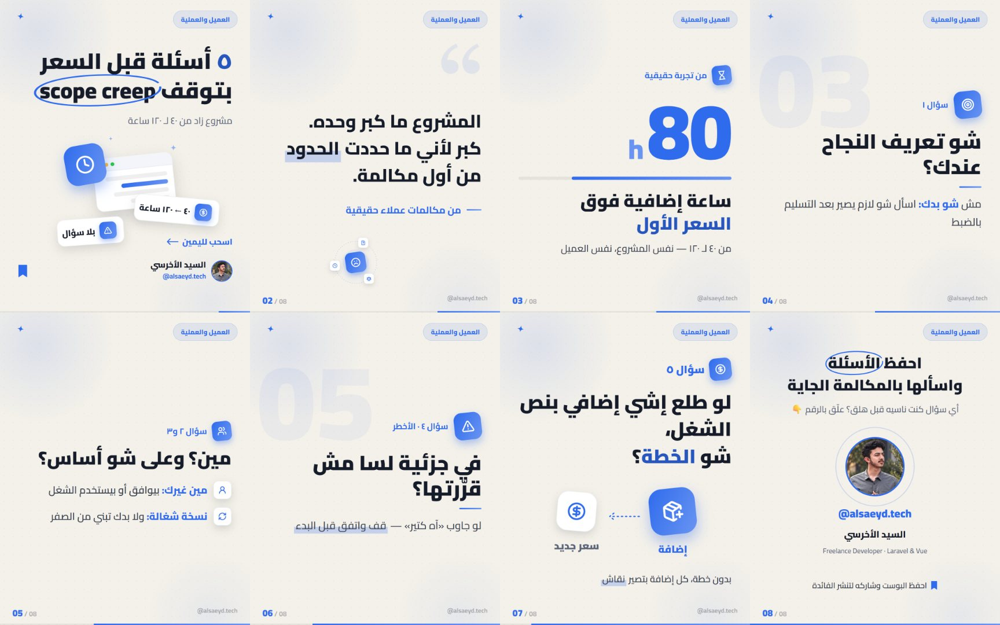
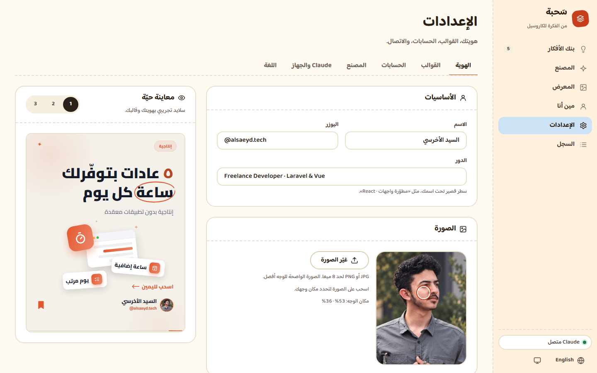
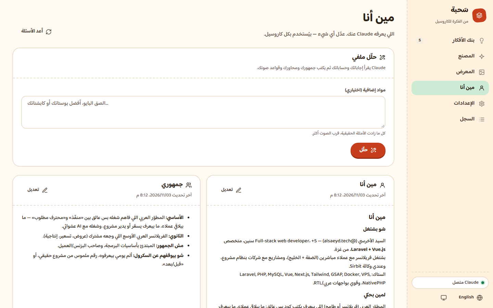
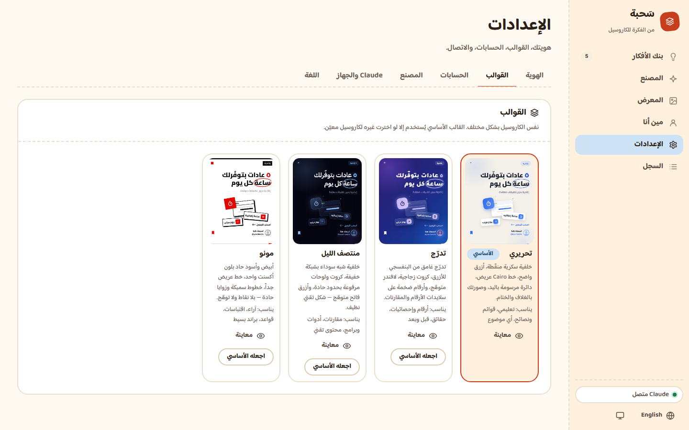
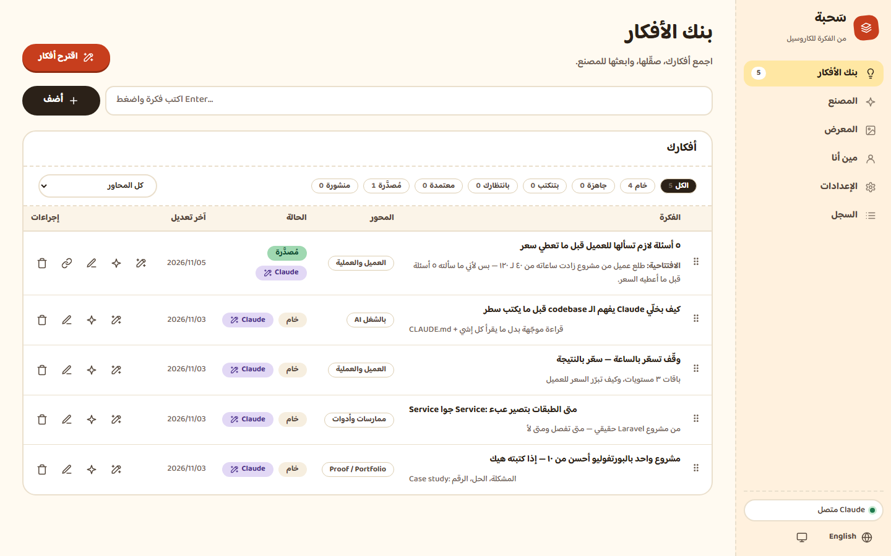
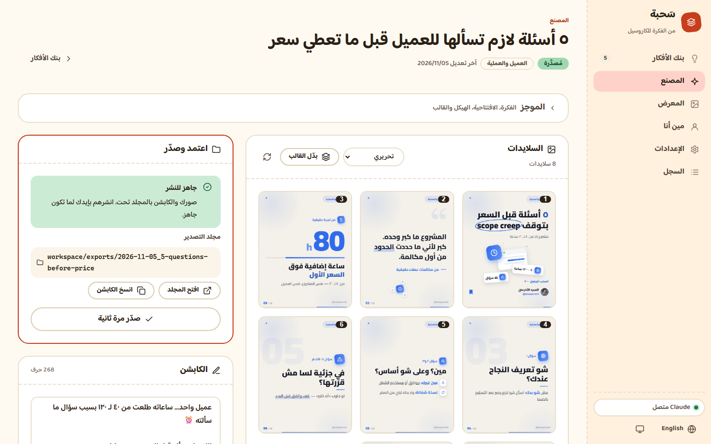
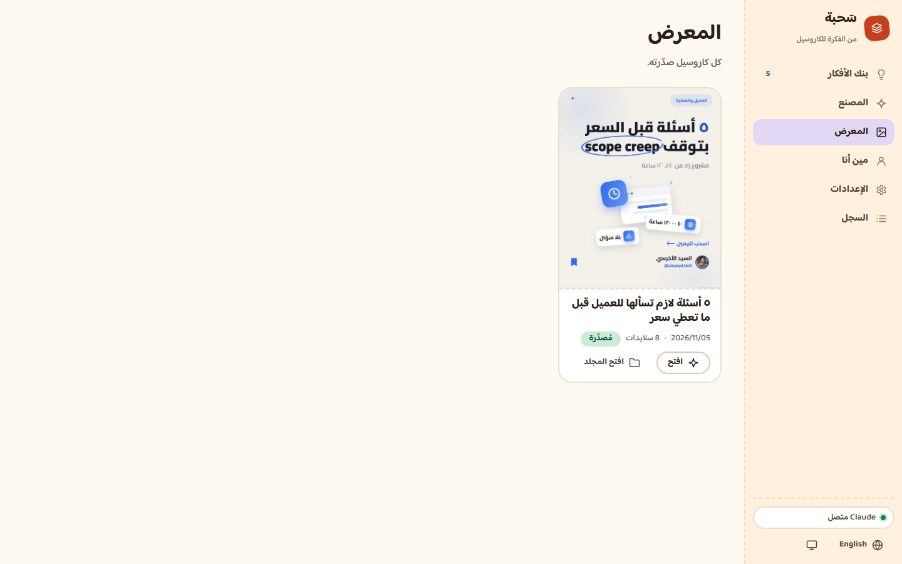

# دليل سَحبة — من الفكرة لكاروسيل جاهز بـ ١٠ دقايق

> بقلم **السيد الأخرسي** · [@alsaeyd.tech](https://instagram.com/alsaeyd.tech) · مطوّر Full-stack (Laravel + Vue)
> سَحبة أداة **مجانية ومفتوحة المصدر** عملتها لنفسي أول، وبعدين قررت أشاركها مع كل صانع محتوى عربي.



---

## ليش عملتها؟
كنت أكتب الكاروسيل بإيدي، وأصممه بإيدي، وكل مرة نفس وجع الراس: النص ما بيطلع بصوتي، والتصميم بياكل ساعتين.
سَحبة بتحل الاثنين: **Claude بيكتب بصوتك إنت** (بعد ما يعرفك)، و**البرنامج بيرسم** صور 1080×1350 بهويتك — وإنت بس بتراجع وبتعتمد.

كل إشي بيشتغل **على جهازك**. ما في سيرفر، ما في اشتراك إضافي، ما في رفع لبياناتك لأي مكان — غير Claude نفسه عبر حسابك.

---

## ١) شو بدك قبل ما تبلّش (٥ دقايق)
| | من وين |
|---|---|
| **Node.js 22+** | [nodejs.org](https://nodejs.org) — نزّل نسخة LTS |
| **Chrome أو Edge** | غالباً موجود عندك |
| **Claude Code** باشتراك Claude (Pro أو Max) | [claude.com/claude-code](https://claude.com/claude-code) ← بعد التثبيت افتح الترمنال واكتب `claude` وسجّل دخول مرة وحدة |

## ٢) نزّلها وشغّلها
1. من صفحة GitHub: زر **Code ← Download ZIP**، أو:
   ```bash
   git clone https://github.com/alsaeyd-alakhras/sahba.git
   ```
2. **ويندوز:** دبل كليك على `start.bat`.
   **ماك:** أول مرة بس `chmod +x start.command`، وبعدين دبل كليك عليه.
3. المتصفح بيفتح لحاله على `http://127.0.0.1:8900`. خلّي نافذة الترمنال مفتوحة.

## ٣) عرّفها عليك (مرة وحدة)
المعالج بيسألك ٤ أشياء: اللغة، أسئلة عنك وعن جمهورك، هويتك، والقالب.



- **الصورة:** ارفع صورتك واسحب لمكان الوجه — المعاينة على اليسار بتتغيّر قدامك.
- **اللون:** لونك الأساسي بيمشي على كل القوالب.
- **نصيحة من تجربتي:** بأسئلة التعريف الصق ٣–٥ بوستات كتبتها إنت. هاي أهم خطوة — منها Claude بيلقط لهجتك وطريقة افتتاحياتك.

بعدها روح على **«مين أنا»** واضغط **«حلّل»**: Claude بيكتب تحليل جمهورك ومحاورك وقواعد صوتك. اقرأها وعدّل أي إشي مش دقيق — كل الكروت قابلة للتعديل.



## ٤) اختار قالبك
أربع قوالب، وكلها بتشوفها **بهويتك إنت** قبل ما تختار. وتقدر تبدّل قالب أي كاروسيل بكبسة بعدين.



| القالب | بيناسب |
|---|---|
| **تحريري** (الافتراضي) | تعليمي، قوائم، أي موضوع |
| **تدرّج** | أرقام وحقائق |
| **منتصف الليل** | مقارنات وأدوات تقنية |
| **مونو** | آراء واقتباسات وبراند بسيط |

## ٥) بنك الأفكار
اكتب فكرتك بسطر واضغط Enter — أو اضغط **«اقترح أفكار»** وClaude بيقترح ١٠ من محاورك.
على أي فكرة اضغط **«صقّل مع Claude»**: بتطلعلك افتتاحية برقم ملموس + هيكل من ٥–٧ نقاط.



## ٦) المصنع — هون السحر
افتح الفكرة واضغط **«اصنع الكاروسيل»**. خلال ٢–٣ دقايق:
1. Claude بيكتب الكاروسيل بصوتك.
2. البرنامج بيفحصه تلقائياً (أيقونات، طول العناوين، الترتيب) — ولو في غلط بيرجعه لـ Claude يصلّحه لحاله.
3. بيرسم السلايدات، وClaude بيطّلع عليها بعينه ويصلّح أي نص مقصوص أو رسمة راكبة.



**مش عاجبك سلايد؟** اضغط عليه واكتب ملاحظة بكلامك العادي («قصّر العنوان»، «خلّي الرقم أوضح») ← «طبّق التعليقات». بيتعدّل بس اللي علّقت عليه.
كل تعديل بينحفظ كنسخة — بتقدر ترجع لأي نسخة سابقة.

## ٧) اعتمد وانشر
اضغط **«اعتمد وصدّر»** ← بيطلعلك مجلد فيه الصور `01.png … 08.png` + `caption.txt`.
- **«افتح المجلد»** و**«انسخ الكابشن»** — وانشر على انستغرام بإيدك (الصور بالترتيب، 01 أول).
- بعد النشر علّم الفكرة «منشورة» وحط رابط البوست، عشان يضل عندك أرشيف مرتّب بـ **المعرض**.



---

## نصايح من الاستخدام
- **فكرة وحدة بكل سلايد.** لو حسّيت السلايد مزحوم، علّق «اقسمه سلايدين».
- **الرقم الملموس بيبيع.** «٥ أسئلة» أقوى من «أسئلة مهمة».
- **راجع أول سطر بالكابشن** دايماً — هو اللي بيظهر قبل «المزيد».
- **لا تنشر إشي ما عشته.** لو الفكرة مش من تجربتك، خلّي Claude يكتبها «تعلّمتها» مش «صارت معي».

## مشكلة؟
صفحة **الإعدادات ← Claude والجهاز** بتفحص كل إشي (Node، المتصفح، Claude، المساحة) وبتقلك شو الناقص بالضبط.
لسا عالق؟ افتح Issue على GitHub، أو ابعتلي على [@alsaeyd.tech](https://instagram.com/alsaeyd.tech).

---

صنعها **السيد الأخرسي** · مجانية ومفتوحة المصدر (MIT) · لو استفدت منها، شاركها مع صانع محتوى بيحتاجها 🤍
